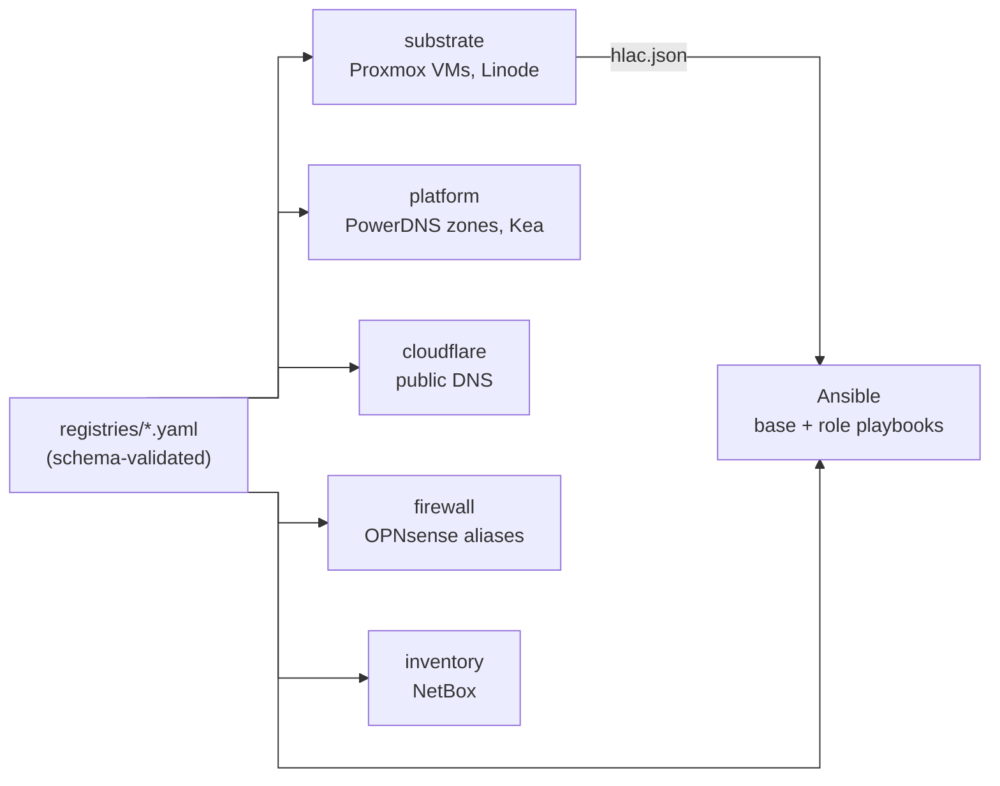

# Homelab as Code (hlac)

## What's in it

- **Compute**: A Proxmox VE cluster, some physical appliances, and a Linode off-site compute.
- **Backups**: Local Proxmox Backup Server with encrypted backups synced offsite to Wasabi.
- **Core Services**: PowerDNS (HA pairs for authoritative and recursor), Kea DHCP, NetBox for Documentation SSoT, Postgres for the core database, and Valkey for cache/queue.
- **Secure Edge**: Caddy serving TLS for internal services on `*.int.ptxe.dev`, a public-facing Caddy ingress edge on `*.ptxe.dev`, and Cloudflare for public DNS management.
- **Network**: OPNense firewall, MikroTik switching, dual-stack IPv4/IPv6 across the board, self-hosted DNS and DHCP.
- **Monitoring**: Grafana stack with prometheus metrics on everything.
- **Remote Access**: NetBird overlay for Site-to-Site and client VPN, with a coffe shop WiFi model.
- **Local LLM**: Local LLM gateway and router with multiple workers and consumers.
- **Apps**: Immich, game servers, my [website](https://klercke.com) and [blog](https://blog.klercke.com), and more.

## How it works

- **Registries are the source of truth.**
    `sites`, `vlans`, `hosts`, `cloud`, `devices`, `services`, and `public_dns` are all plain YAML files.
    They are validated against JSON schemas on commit.
    See [`registries/README.md`](registries/README.md).
- **Derived values share a source.**
    Addresses, VLAN IDs, VMIDs, MACs, DNS records, tags, etc. are all computed from the registries in `terraform/modules/registry` so they won't drift apart.
- **OpenTofu builds, then Ansible configures.**
    OpenTofu creates resources and writes to anything with a good API, plus creates `hlac.json`, which is consumed by Ansible.
    Ansible reads the registries via `hlac.json`, then configures the hosts according to their roles.
- **Secrets are encrypted via SOPS.**
    SOPS lets me store the secrets in [age](https://age-encryption.org/)-encrypted files so they can be easily and automatically consumed.

## Layout

| Path | What it is |
|---|---|
| `registries/` | The YAML registries and their JSON Schemas |
| `terraform/substrate/` | Proxmox VMs and cloud hosts, also generates `hlac.json` for Ansible |
| `terraform/platform/` | PowerDNS zones and records, Kea subnets and reservations |
| `terraform/cloudflare/` | Public DNS zones |
| `terraform/firewall/` | Host and role aliases on the OPNsense firewall |
| `terraform/inventory/` | NetBox: sites, racks, devices, VMs, VLANs, prefixes, addresses, services |
| `terraform/modules/registry/` | The glue to pull information from the registries and give it to OpenTofu consumers |
| `ansible/` | The base role, one role per service, and a playbook per role. See [`ansible/README.md`](ansible/README.md) |
| `installer/` | Unattended-install answer files |
| `network/` | Network appliance configuration |
| `prompts/` | System prompts for the local LLM gateway |
| `scripts/` | Installer ISO builder, secret generation, and other helpers |
| `keys/` | Public keys |
| `secrets/` | SOPS-encrypted secrets |

## Operations

Everything comes from the Nix dev shell (`nix develop`, or direnv), which also installs the pre-commit hooks.
Each Terraform layer and the Ansible directory have their own `.envrc` holding credentials and every recipe runs through `direnv exec` in that directory.

| Command | What it does |
|---|---|
| `just apply` | Run the whole pipeline in order (SLOW) |
| `just hypervisors` | Configure the Proxmox hosts themselves |
| `just substrate` | Create and resize VMs, regenerate `hlac.json` |
| `just base` | Base configuration on every VM |
| `just platform` | DNS records and Kea reservations |
| `just cloudflare` | Public DNS |
| `just firewall` | Firewall aliases |
| `just playbooks` | Every role playbook in dependency order |
| `just role <name>` | One role playbook (extra args pass through to `ansible-playbook`) |
| `just inventory` | Record everything in NetBox |
| `just plan` | Preview every Terraform layer |
| `just service` | Publish a new public service from `services.yaml` |
| `just device` | Create records for a new device from `devices.yaml` |
| `just iso <host> <iso>` | Build an unattended installer ISO for a physical host |

The jobs must be run in dependency order: substrate, then base, then platform, Cloudflare, and firewall, then the role playbooks, then inventory last.

## Checks

The pre-commit hooks (run by [prek](https://github.com/j178/prek), defined in `flake.nix`) cover:

- OpenTofu formatting and validation, tflint, and terraform-docs for every module README
- yamllint (quoted strings, no YAML 1.1 truthy values) and JSON Schema validation for the registries
- Secrets are SOPS-encrypted to exactly three recipients (myself, the CI key, and a break-glass backup), and no age private key is ever committed
- YAML syntax, trailing whitespace, end-of-file, and large files

CI runs the same hooks on every push and pull request.

## Roadmap

- [x] IPv6 for clients, DNS, public services, and VMs
- [ ] IPv6 for backends (drop IPv4 between services)
- [x] Every host creates an alias in the firewall
- [ ] Kubernetes for workloads
- [x] CI linting
- [ ] CD deploys
- [ ] Renovate or similar
- [ ] Automatically generate diagrams from registry
- [ ] HA Postgres
- [ ] Identity Provider
- [ ] Firewall/switch management(?)
- [ ] More Grafana dashboards
- [ ] Logs and SNMP into monitoring server
- [ ] Show connections in Netbox
- [x] Proxmox answer files
- [ ] Rebuild all "legacy" lab hosts in code
- [ ] Proxmox Datacenter Manager
- [x] Public ingress edge (replaces nginx-tmp)
- [x] Encrypted offsite backups
- [x] PVE cluster
- [ ] SMART alerts
- [ ] Backup age alerts
- [ ] HA for high-crit VMs
- [ ] Scheduled test restores?
- [ ] Cross-node ZFS replication
- [ ] Automatic drift scanning, detection, and alerting
- [x] Netbird peers
- [ ] Netbird management in code
- [ ] Move existing VMs to `vmdata`
- [ ] Local S3 bucket for Pelican backups
- [ ] Radicale or similar DAV server
- [x] Add Linode management
- [ ] Replace existing Linode
- [ ] Add public status page
- [ ] Add a cool MOTD to all servers :)
